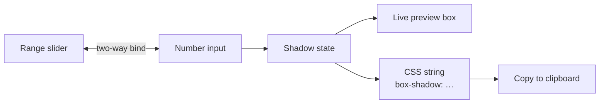

<h1 align="center">ShadowForge — CSS Shadow Generator</h1>

<p align="center"><b>A zero-dependency `box-shadow` generator with live preview and copy-ready CSS output.</b></p>

<p align="center">
<a href="https://mister2314.github.io/shadowforge-css-generator/"></a>


</p>

<p align="center"><a href="https://mister2314.github.io/shadowforge-css-generator/"><b>Live demo</b></a> &nbsp;·&nbsp; <a href="#quick-start">Quick start</a> &nbsp;·&nbsp; <a href="#features">Features</a> &nbsp;·&nbsp; <a href="#architecture">Architecture</a> &nbsp;·&nbsp; <a href="#faq">FAQ</a></p>

<p align="center">
  <a href="https://mister2314.github.io/shadowforge-css-generator/">
    
  </a>
</p>

<p align="center"><sub>Live capture of the real build — 292 KB, loops forever.</sub></p>

## Overview

`box-shadow` is easy to read and annoying to write. ShadowForge turns it into a control panel: drag the sliders until the preview looks right, then copy the generated CSS.

Every control exists twice — a range slider for feel and a number input for precision — and the two are kept in sync in both directions. The generator covers the full shadow syntax, including spread radius, colour, opacity and the `inset` flag, and updates the preview on every input event.

It is plain HTML, CSS and JavaScript with no build step and no dependencies, which is deliberate: the file you deploy is the file you edit.

## At a glance

| Field | Detail |
| --- | --- |
| **Type** | Static site — no build step |
| **Primary language** | CSS |
| **Live demo** | [mister2314.github.io/shadowforge-css-generator](https://mister2314.github.io/shadowforge-css-generator/) |
| **Repository** | [Mister2314/shadowforge-css-generator](https://github.com/Mister2314/shadowforge-css-generator) |

## Features

- Sliders and number inputs kept in sync for offset X, offset Y, blur and spread
- Colour picker paired with a hex input, plus a separate opacity control
- `inset` toggle for inner shadows
- Live preview box that re-renders on every input event
- Generated CSS output with a copy-to-clipboard button
- Glassmorphism panel layout on a gradient background
- No dependencies, no build step — open `index.html` and it runs

## Tech Stack

| Layer | Technology |
| --- | --- |
| Markup | HTML5 |
| Styling | CSS3 (grid, custom properties, `backdrop-filter`) |
| Logic | Vanilla JavaScript |
| Deploy | GitHub Pages |

## Architecture



## Screenshots

| Desktop | Mobile |
| :---: | :---: |
|  |  |

## Quick Start

```bash
git clone https://github.com/Mister2314/shadowforge-css-generator.git
cd shadowforge-css-generator

# open it directly
start index.html      # Windows
open  index.html      # macOS

# or serve the folder
npx serve .
```

## Project Structure

```
index.html — control panel markup and the preview box
script.js — control registry, two-way binding, CSS generation, clipboard
style.css — layout, glass panels and control styling
```

## FAQ

<details>
<summary><b>How do the slider and the number box stay in sync?</b></summary>

They write to the same state value and re-render each other. Dragging the slider moves the number; typing a number moves the slider.

</details>

<details>
<summary><b>Does it support inset shadows?</b></summary>

Yes — the `inset` toggle switches the generated value to an inner shadow, and the preview updates immediately.

</details>

<details>
<summary><b>Is there a build step?</b></summary>

No. It is three static files. Open `index.html` and it runs.

</details>

## Roadmap

- [ ] Add multi-layer shadow support
- [ ] Save and share presets via the URL
- [ ] Add a contrast warning for the chosen shadow colour

## Notes

The interesting constraint was keeping slider and number input honest: each pair writes to the same source of truth and re-renders the other, so dragging a slider moves the number and typing a number moves the slider.

## Author

**Xəyal Hüseynli** — Junior Front-End Developer

[Portfolio](https://hypnosdev.vercel.app) · [GitHub](https://github.com/Mister2314) · [LinkedIn](https://www.linkedin.com/in/x%C9%99yal-h%C3%BCseynli-3487b91ba/) · [xeyalhuseynli06@gmail.com](mailto:xeyalhuseynli06@gmail.com)
