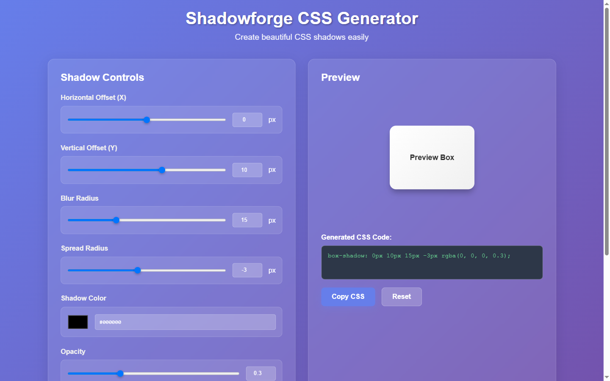
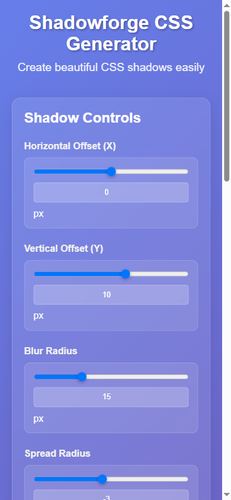
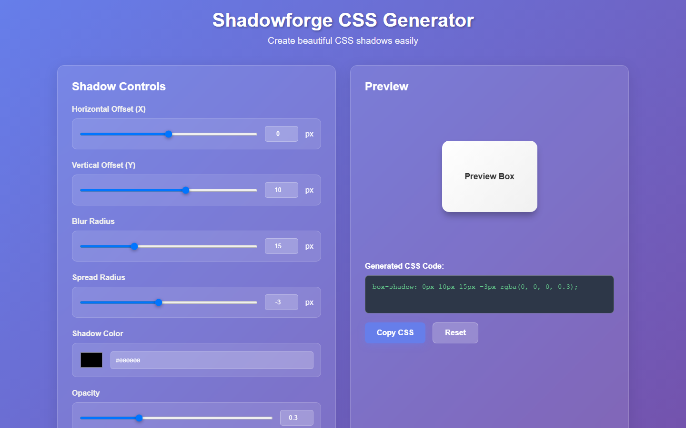
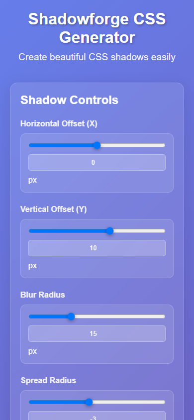

# ShadowForge — CSS Shadow Generator

Zero-dependency `box-shadow` generator with a live preview and copy-ready CSS output.

**Live demo:** https://shadowforge-css-generator.vercel.app

<div align="center">


| Desktop | Mobile |
|---|---|
|  |  |

<details>
<summary>More screenshots</summary>

| Desktop | Mobile |
|---|---|
|  |  |

</details>

</div>

## What it does

Turns `box-shadow` into a control panel: drag sliders, watch the preview box re-render on every input event, copy the generated CSS. Each control exists twice — a range slider for feel and a number input for precision — and every pair writes to the same state value and re-renders the other. Three static files, no build step.

## Tech stack

React 19 · TypeScript · Vite

## Features

- Sliders and number inputs kept in sync both ways for offset X/Y, blur, spread and opacity
- Colour picker paired with a hex input
- `inset` toggle for inner shadows
- Live preview box that re-renders on every input event
- Copy-to-clipboard on the generated CSS string

## Run locally

```bash
git clone https://github.com/Mister2314/shadowforge-css-generator.git
cd shadowforge-css-generator
npx serve .        # or just open index.html
```

## What I learned

The hard part was keeping slider and number input honest: each pair writes to one source of truth and re-renders the other, so dragging moves the number and typing moves the slider — with no feedback loop.
